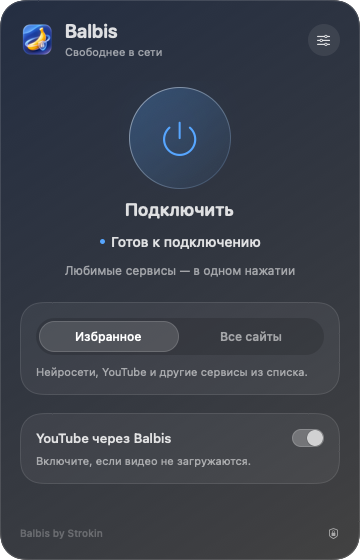

[Русский](README.md) · [English](README.en.md) · [简体中文](README.zh-CN.md) · [Українська](README.uk.md)

<p align="center"></p>
<h1 align="center">BalbisNotVPN</h1>
<p align="center">Balbis by Strokin · a native menu bar app for macOS 13+</p>

Balbis opens selected websites through local TCP processing or an overseas proxy. Its menu bar panel provides connection controls, routing modes, region selection, custom domains, launch at login, and connection recovery.

<p align="center">


</p>

An independent macOS project. The ready-to-use app runs without Homebrew, Python, Go, drivers, or a separate VPN client. The application interface is currently in Russian; these documents translate the instructions.

## Download 0.7.1

- [Apple Silicon — Balbis-0.7.1-macOS-arm64.dmg](https://github.com/Strokln/BalbisNotVPN/releases/download/v0.7.1/Balbis-0.7.1-macOS-arm64.dmg)
- [Intel — Balbis-0.7.1-macOS-x86_64.dmg](https://github.com/Strokln/BalbisNotVPN/releases/download/v0.7.1/Balbis-0.7.1-macOS-x86_64.dmg)

Choose the build for your processor. Each disk image contains the app and a shortcut to Applications. SHA-256 checksums are available in the release.

## Interface

<p align="center"></p>

A render of the native panel. Settings open inside the same popover.

## Stability fixes in 0.7.1

- Background checks keep the interface in its connected state.
- A single failed check or an HTTP 403, 429, or 5xx response no longer restarts the whole tunnel.
- Recovery requires consecutive transport failures and checks multiple endpoints.
- Stale process-exit events are acted on only when the current session is unhealthy.
- Diagnostics includes a log of reconnection reasons.

## Install and connect

1. Open the DMG and drag **Balbis.app** into **Applications**.
2. Launch Balbis from Applications. If macOS blocks it, use **Open** in its context menu or allow it in Privacy & Security settings. Builds are ad-hoc signed and have not been notarized by Apple.
3. Select the routing mode and network service, enable an overseas connection if needed, and click **«Подключить»** (Connect).

The first system-proxy connection asks for an administrator password to install a restricted helper. Subsequent connections use that helper. It can check readiness, enable Balbis's loopback PAC, and restore previous settings. It cannot run arbitrary commands. The helper serves one authorized user account. Reinstallation or a change of user may require authorization again.

If another app or VPN already controls the proxy settings, disconnect it first. In manual mode, configure the apps you want to use with Balbis's local proxy; system PAC settings are kept under their existing control.

## Settings

- **Overseas connection** routes selected domains through the shared Opera/SurfEasy service. Select a region in settings; availability depends on the service.
- **«Мои сайты»** (My sites) adds domains to the overseas list. Enter domains without `https://` or paths. A rule includes its subdomains. Changes apply at the next connection and require the overseas connection to be enabled.
- **YouTube** can be included in the overseas route separately.
- **«Запускать вместе с macOS»** (Launch with macOS) starts Balbis after you log in. **«Подключаться автоматически»** (Connect automatically) connects with saved settings once the network is ready. Enable both to connect at login. If macOS requests approval, allow the login item in System Settings.
- **«Восстановить настройки»** (Restore settings) restores an unfinished session's proxy settings. Use recovery first if Balbis reports a remaining recovery journal.
- **«Удалить службу подключения»** (Remove connection helper) is in Diagnostics and requires administrator authorization. Disconnect Balbis and restore any unfinished session before removing it.

## Scope and limitations

Balbis uses proxies and TCP processing. It does not provide system-wide TUN routing, UDP, QUIC, or voice-call support. Applications that ignore the system proxy may connect directly. “All sites” applies to apps using the selected proxy and does not cover every network connection on the Mac.

The shared overseas exit may be slow or unavailable. Websites can reject its IP address, request verification, or return HTTP 403. A successful exit check does not guarantee access to every page or account. TCP processing strategies also cannot guarantee access through a particular block.

Runtime testing was performed on **macOS 13 Ventura, Intel**. Apple Silicon builds were compiled but have not been run on a physical device. **macOS 27 has not been tested**. Builds are ad-hoc signed, have not been notarized, and do not include automatic updates.

## Build from source

You need macOS and Apple Command Line Tools (`xcode-select --install`).

```sh
./macos/build.sh universal
# Or build a single architecture:
./macos/build.sh x86_64
./macos/build.sh arm64
```

The script produces `macos/build/Balbis.app` and a ZIP. To create architecture-specific disk images from the universal archive:

```sh
./macos/package-dmg.sh arm64
./macos/package-dmg.sh x86_64
```

The scripts compile tpws from the included sources. SHA-256-pinned opera-proxy binaries and, when necessary, Go for the router are downloaded into local project directories. The first build needs network access. No global Go or Homebrew installation is required. Downloaded tools and build output are excluded from the repository.

Run checks with `./macos/test.sh` and `./macos/test-runtime.sh`. They use local test servers and isolated settings for lifecycle tests. A real overseas connection is checked separately.

## Source and licenses

Balbis's native code is licensed under [MIT, © 2026 Strokin](LICENSE). The initial domain list was built from the list supplied by the user.

Third-party components retain their licenses and authorship:

- **tpws / zapret**, MIT — [sources and pinned version](macos/engine/README.md), [notices](macos/engine/THIRD_PARTY_NOTICES.md).
- **epoll-shim** and included headers — [license](macos/engine/EPOLL-SHIM-LICENSE) and notices in the source files.
- **opera-proxy 1.31.0**, MIT — [sources and description](macos/tunnel/README.md), [license](macos/tunnel/LICENSE), [dependency notices](macos/tunnel/THIRD_PARTY_NOTICES.md), [full license texts](macos/tunnel/licenses).
- **Go runtime and dependencies** retain their applicable BSD, MIT, Apache, and other notices in those files.

Balbis is not affiliated with or supported by Opera or SurfEasy. Their public service has its own terms and availability limits.
