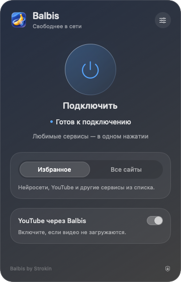

[Русский](README.md) · [English](README.en.md) · [简体中文](README.zh-CN.md) · [Українська](README.uk.md)

<p align="center"></p>
<h1 align="center">BalbisNotVPN</h1>
<p align="center">Balbis by Strokin · нативное приложение для macOS 13+</p>

Balbis помогает открывать выбранные сайты через локальную обработку TCP или зарубежный прокси. В панели строки меню доступны подключение, выбор режима и региона, свои домены, автозапуск и восстановление настроек.

<p align="center">


</p>

Самостоятельный проект для macOS. Интерфейс приложения пока на русском; переводы README описывают работу с ним. Для запуска готового приложения не нужны Homebrew, Python, Go, драйверы или отдельный VPN-клиент.

## Скачать 0.7.1

- [Apple Silicon — Balbis-0.7.1-macOS-arm64.dmg](https://github.com/Strokln/BalbisNotVPN/releases/download/v0.7.1/Balbis-0.7.1-macOS-arm64.dmg)
- [Intel — Balbis-0.7.1-macOS-x86_64.dmg](https://github.com/Strokln/BalbisNotVPN/releases/download/v0.7.1/Balbis-0.7.1-macOS-x86_64.dmg)

Выберите сборку для своего процессора. В каждом образе есть приложение и ссылка на папку «Программы».

## Интерфейс

<p align="center"></p>

Рендер нативной панели. Настройки открываются внутри того же всплывающего окна.

## Что исправлено в 0.7.1

- Фоновая проверка больше не показывает состояние переподключения.
- Один неудачный запрос или ответ сайта 403/429/5xx не перезапускает весь туннель.
- Добавлены проверка нескольких адресов и порог последовательных транспортных ошибок.
- Устаревшее событие завершения процесса учитывается только при неисправном текущем сеансе.
- В диагностике доступен журнал причин переподключений.

## Установка и подключение

1. Откройте DMG и перенесите **Balbis.app** в «Программы».
2. Запустите Balbis оттуда. Если macOS блокирует приложение, используйте «Открыть» в контекстном меню или разрешите запуск в системных настройках конфиденциальности и безопасности. Подпись локальная (ad-hoc), нотариального заверения Apple нет.
3. Выберите нужный режим, сетевую службу и при необходимости зарубежный выход. Нажмите «Подключить».

Первое системное подключение требует пароля администратора для установки ограниченной службы. Последующие подключения используют эту службу. Она может только проверять готовность, включать локальный PAC Balbis и восстанавливать прежние параметры; произвольные команды не выполняет. Служба обслуживает одну разрешённую учётную запись. Переустановка или смена пользователя может потребовать повторного разрешения.

Если настройки прокси уже заняты другим приложением или VPN, сначала завершите его подключение. В локальном режиме приложения нужно самостоятельно направлять на прокси Balbis; системный PAC не меняется.

## Настройки

- **Зарубежное подключение** направляет выбранные домены через общий сервис Opera/SurfEasy. Регион выбирается в настройках; фактическая доступность зависит от сервиса.
- **Мои сайты** дополняют зарубежный список. Вводите домены без `https://` и путей; правило охватывает поддомены. Изменения применяются при следующем подключении. Для зарубежного маршрута должен быть включён зарубежный выход.
- **YouTube** можно включать в зарубежный маршрут отдельно.
- **Запускать вместе с macOS** открывает приложение после входа. **Подключаться автоматически** начинает подключение с сохранёнными параметрами после появления сети. Для подключения после входа включите оба переключателя. Если macOS требует подтверждения, разрешите автозапуск в системных настройках.
- **Восстановить настройки** возвращает настройки незавершённого сеанса. Сначала используйте восстановление, если приложение сообщает об оставшемся журнале.
- **Удалить службу подключения** находится в диагностике и требует разрешения администратора. Сначала отключите Balbis и восстановите оставшиеся настройки.

## Возможности и ограничения

Balbis использует локальные SOCKS/HTTP-прокси и системный PAC. **Это не TUN и не полноценный VPN**: UDP/QUIC не туннелируется, а программы, игнорирующие системные прокси, могут обращаться в сеть напрямую. Режим «Все сайты» относится к приложениям, использующим выбранный прокси, и не охватывает весь трафик компьютера.

Общий зарубежный выход может быть медленным или недоступным. Сайты могут отклонять общий IP, требовать проверку или возвращать HTTP 403. Успешная проверка выхода не гарантирует доступ ко всем страницам и аккаунтам. Стратегии обработки TCP также не гарантируют обход конкретной блокировки.

Работа проверялась на **macOS 13 Ventura, Intel**. Apple Silicon скомпилирован, но не проверен на реальном устройстве. **macOS 27 не проверялась**. Сборки подписаны ad-hoc, не заверены Apple и не имеют автоматического обновления.

## Сборка из исходников

Нужны macOS и Apple Command Line Tools (`xcode-select --install`).

```sh
./macos/build.sh universal
# Или только своя архитектура:
./macos/build.sh x86_64
./macos/build.sh arm64
```

Сборка создаёт `macos/build/Balbis.app` и ZIP. Для DMG из universal-архива:

```sh
./macos/package-dmg.sh arm64
./macos/package-dmg.sh x86_64
```

Скрипты собирают tpws из включённых исходников. Проверенные по SHA-256 бинарники opera-proxy и при необходимости Go для маршрутизатора скачиваются в локальные папки проекта. Первая сборка требует сети; глобальная установка Go/Homebrew не нужна. Загруженные инструменты и результаты сборки в репозиторий не включены.

Проверки запускаются командами `./macos/test.sh` и `./macos/test-runtime.sh`. Они используют локальные тестовые серверы и изолированные настройки для проверок жизненного цикла. Ручная проверка реального зарубежного выхода проводится отдельно.

## Исходники и лицензии

Код Balbis — [MIT, © 2026 Strokin](LICENSE). Начальный список доменов сформирован из предоставленного пользователем перечня.

Сторонние компоненты сохраняют свои лицензии и авторство:

- **tpws / zapret**, MIT: [исходники и закреплённая версия](macos/engine/README.md), [уведомления](macos/engine/THIRD_PARTY_NOTICES.md).
- **epoll-shim** и включённые заголовки: [лицензия](macos/engine/EPOLL-SHIM-LICENSE), уведомления в исходниках.
- **opera-proxy 1.31.0**, MIT: [исходники и описание](macos/tunnel/README.md), [лицензия](macos/tunnel/LICENSE), [уведомления и зависимости](macos/tunnel/THIRD_PARTY_NOTICES.md), [полные тексты лицензий](macos/tunnel/licenses).
- **Go runtime и зависимости** сохраняют BSD/MIT/Apache и другие применимые уведомления в указанных файлах.

Проект не связан с Opera или SurfEasy и не поддерживается ими. Их публичный сервис имеет собственные условия и ограничения доступности.
