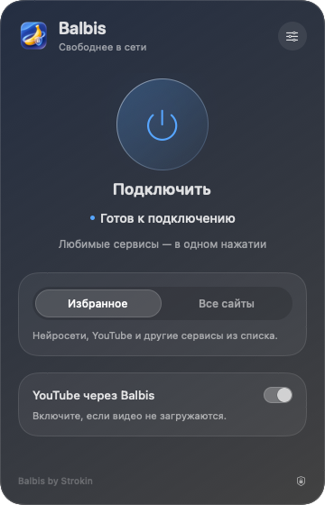

[Русский](README.md) · [English](README.en.md) · [简体中文](README.zh-CN.md) · [Українська](README.uk.md)

<p align="center"></p>
<h1 align="center">BalbisNotVPN</h1>
<p align="center">Balbis by Strokin · нативний застосунок для macOS 13+</p>

Balbis допомагає відкривати вибрані сайти завдяки локальній обробці TCP або закордонному проксі. На панелі в рядку меню доступні підключення, вибір режиму й регіону, власні домени, автозапуск і відновлення налаштувань.

<p align="center">


</p>

Самостійний проєкт для macOS. Для запуску готового застосунку не потрібні Homebrew, Python, Go, драйвери чи окремий VPN-клієнт.

## Завантажити 0.7.1

- [Apple Silicon — Balbis-0.7.1-macOS-arm64.dmg](https://github.com/Strokln/BalbisNotVPN/releases/download/v0.7.1/Balbis-0.7.1-macOS-arm64.dmg)
- [Intel — Balbis-0.7.1-macOS-x86_64.dmg](https://github.com/Strokln/BalbisNotVPN/releases/download/v0.7.1/Balbis-0.7.1-macOS-x86_64.dmg)

Виберіть збірку для свого процесора. Кожен образ містить застосунок і посилання на папку «Програми».

## Інтерфейс

<p align="center"></p>

Рендер нативної панелі. Налаштування відкриваються в тому самому спливному вікні. **Інтерфейс застосунку наразі російською**; нижче збережено точні назви пунктів із поясненнями українською.

## Що виправлено у 0.7.1

- Фонова перевірка більше не показує стан повторного підключення.
- Один невдалий запит або відповідь сайту 403/429/5xx не перезапускає весь тунель.
- Додано перевірку кількох адрес і поріг послідовних транспортних помилок.
- Застаріла подія завершення процесу враховується лише тоді, коли поточний сеанс несправний.
- У діагностиці доступний журнал причин повторних підключень.

## Встановлення та підключення

1. Відкрийте DMG і перенесіть **Balbis.app** до папки «Програми».
2. Запустіть Balbis звідти. Якщо macOS блокує застосунок, скористайтеся пунктом «Відкрити» в контекстному меню або дозвольте запуск у системних параметрах приватності й безпеки. Підпис локальний (ad-hoc), нотаризації Apple немає.
3. Виберіть потрібний режим, мережеву службу й за потреби закордонний вихід. Натисніть **«Подключить» (підключити)**.

Перше системне підключення потребує пароля адміністратора для встановлення служби з обмеженими можливостями. Наступні підключення використовують цю службу. Вона може лише перевіряти готовність, вмикати локальний PAC Balbis і відновлювати попередні параметри; довільних команд не виконує. Служба обслуговує один дозволений обліковий запис. Перевстановлення або зміна користувача може потребувати повторного дозволу.

Якщо налаштуваннями проксі вже керує інший застосунок або VPN, спершу завершіть його підключення. У локальному режимі потрібно самостійно налаштувати застосунки на використання проксі Balbis; системний PAC не змінюється.

## Налаштування

- **«Зарубежное подключение» (закордонний вихід)** спрямовує вибрані домени через спільний сервіс Opera/SurfEasy. Регіон вибирається в налаштуваннях; фактична доступність залежить від сервісу.
- **«Мои сайты» (мої сайти)** доповнюють закордонний список. Вводьте домени без `https://` і шляхів; правило охоплює піддомени. Зміни застосовуються під час наступного підключення. Для закордонного маршруту потрібно ввімкнути закордонний вихід.
- **YouTube** можна додавати до закордонного маршруту окремо.
- **«Запускать вместе с macOS» (запускати разом із macOS)** відкриває застосунок після входу. **«Подключаться автоматически» (підключатися автоматично)** починає підключення зі збереженими параметрами після появи мережі. Щоб підключатися після входу, увімкніть обидва перемикачі. Якщо macOS потребує підтвердження, дозвольте автозапуск у системних параметрах.
- **«Восстановить настройки» (відновити налаштування)** повертає налаштування незавершеного сеансу. Спершу скористайтеся відновленням, якщо застосунок повідомляє про залишений журнал.
- **«Удалить службу подключения» (видалити службу підключення)** розташовано в діагностиці; ця дія потребує дозволу адміністратора. Спершу відключіть Balbis і відновіть залишені налаштування.

## Можливості та обмеження

Balbis використовує локальні SOCKS/HTTP-проксі та системний PAC. **Це не TUN і не повноцінний VPN**: UDP/QUIC не тунелюється, а програми, що ігнорують системні проксі, можуть звертатися до мережі напряму. Режим **«Все сайты» (усі сайти)** стосується застосунків, які використовують вибраний проксі, і не охоплює весь трафік комп’ютера.

Спільний закордонний вихід може бути повільним або недоступним. Сайти можуть відхиляти спільну IP-адресу, вимагати перевірку або повертати HTTP 403. Успішна перевірка виходу не гарантує доступу до всіх сторінок та облікових записів. Стратегії обробки TCP також не гарантують обходу конкретного блокування.

Роботу перевірено на **macOS 13 Ventura, Intel**. Версію для Apple Silicon скомпільовано, але не перевірено на реальному пристрої. **macOS 27 не перевірялася**. Збірки підписані ad-hoc, не нотаризовані Apple й не мають автоматичного оновлення.

## Збирання з вихідного коду

Потрібні macOS та Apple Command Line Tools (`xcode-select --install`).

```sh
./macos/build.sh universal
# Або лише потрібна архітектура:
./macos/build.sh x86_64
./macos/build.sh arm64
```

Збирання створює `macos/build/Balbis.app` і ZIP. Щоб отримати DMG з universal-архіву:

```sh
./macos/package-dmg.sh arm64
./macos/package-dmg.sh x86_64
```

Скрипти збирають tpws із включеного вихідного коду. Бінарні файли opera-proxy, перевірені за SHA-256, і за потреби Go для маршрутизатора завантажуються до локальних папок проєкту. Перше збирання потребує мережі; глобальне встановлення Go/Homebrew не потрібне. Завантажені інструменти й результати збирання не включено до репозиторію.

Перевірки запускаються командами `./macos/test.sh` і `./macos/test-runtime.sh`. Вони використовують локальні тестові сервери та ізольовані налаштування для перевірок життєвого циклу. Ручна перевірка реального закордонного виходу проводиться окремо.

## Вихідний код і ліцензії

Код Balbis — [MIT, © 2026 Strokin](LICENSE). Початковий список доменів сформовано з переліку, наданого користувачем.

Сторонні компоненти зберігають свої ліцензії та авторство:

- **tpws / zapret**, MIT: [вихідний код і зафіксована версія](macos/engine/README.md), [повідомлення](macos/engine/THIRD_PARTY_NOTICES.md).
- **epoll-shim** і включені заголовки: [ліцензія](macos/engine/EPOLL-SHIM-LICENSE), повідомлення у вихідному коді.
- **opera-proxy 1.31.0**, MIT: [вихідний код і опис](macos/tunnel/README.md), [ліцензія](macos/tunnel/LICENSE), [повідомлення й залежності](macos/tunnel/THIRD_PARTY_NOTICES.md), [повні тексти ліцензій](macos/tunnel/licenses).
- **Середовище виконання Go та залежності** зберігають BSD/MIT/Apache й інші застосовні повідомлення в зазначених файлах.

Проєкт не пов’язаний з Opera чи SurfEasy і не підтримується ними. Їхній публічний сервіс має власні умови та обмеження доступності.
