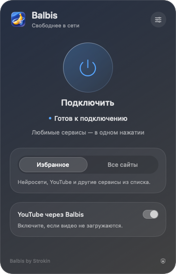

[Русский](README.md) · [English](README.en.md) · [简体中文](README.zh-CN.md) · [Українська](README.uk.md)

<p align="center"></p>
<h1 align="center">BalbisNotVPN</h1>
<p align="center">Balbis by Strokin · 适用于 macOS 13+ 的原生应用</p>

Balbis 通过本地 TCP 处理或境外代理，帮助访问指定网站。菜单栏面板提供连接、模式和地区选择、自定义域名、登录时启动及设置恢复功能。

<p align="center">


</p>

这是一个独立的 macOS 项目。运行已编译的应用无需安装 Homebrew、Python、Go、驱动程序或其他 VPN 客户端。

## 下载 0.7.1

- [Apple Silicon — Balbis-0.7.1-macOS-arm64.dmg](https://github.com/Strokln/BalbisNotVPN/releases/download/v0.7.1/Balbis-0.7.1-macOS-arm64.dmg)
- [Intel — Balbis-0.7.1-macOS-x86_64.dmg](https://github.com/Strokln/BalbisNotVPN/releases/download/v0.7.1/Balbis-0.7.1-macOS-x86_64.dmg)

请选择与处理器匹配的版本。每个磁盘映像都包含应用及“应用程序”文件夹的链接。

## 界面

<p align="center"></p>

上图为原生面板的渲染图。设置在同一个弹出窗口内打开。**应用界面目前为俄语**；下文保留俄语菜单名称，并附中文说明。

## 0.7.1 修复内容

- 后台检查不再显示为正在重新连接。
- 单次请求失败或网站返回 403/429/5xx，不再触发整个隧道重启。
- 增加了多个地址的检查，以及连续传输错误的触发阈值。
- 只有当前会话确实存在故障时，才会处理过期的进程退出事件。
- 诊断页面新增重新连接原因日志。

## 安装与连接

1. 打开 DMG，将 **Balbis.app** 拖入“应用程序”文件夹。
2. 从该文件夹启动 Balbis。如果 macOS 阻止启动，可使用右键菜单中的“打开”，或前往系统设置的“隐私与安全性”允许启动。应用采用本地 ad-hoc 签名，未经 Apple 公证。
3. 选择所需模式、网络服务，并按需启用境外出口。点击 **«Подключить»（连接）**。

首次系统连接需要管理员密码，以安装功能受限的辅助服务。后续连接使用该服务。它仅能检查就绪状态、启用 Balbis 本地 PAC，以及恢复先前设置，不能执行任意命令。服务仅授权一个用户账户使用。重新安装或更换用户时，可能需要再次授权。

如果其他应用或 VPN 已在管理代理设置，请先断开其连接。在本地模式下，需要自行将应用配置为使用 Balbis 代理；系统 PAC 不会改变。

## 设置

- **«Зарубежное подключение»（境外出口）**：通过 Opera/SurfEasy 的共享服务转发指定域名。可在设置中选择地区；实际可用性取决于该服务。
- **«Мои сайты»（我的网站）**：补充境外路由列表。请输入域名，不要包含 `https://` 或路径；规则也适用于子域名。更改将在下次连接时生效。使用境外路由前，必须启用境外出口。
- **YouTube**：可单独决定是否通过境外路由访问。
- **«Запускать вместе с macOS»（登录 macOS 时启动）**：登录后打开应用。**«Подключаться автоматически»（自动连接）**：网络可用后，使用已保存的设置开始连接。如需登录后自动连接，请同时开启这两个选项。如果 macOS 要求确认，请在系统设置中允许登录时启动。
- **«Восстановить настройки»（恢复设置）**：恢复未正常结束的会话所修改的设置。如果应用提示存在遗留日志，请先执行恢复。
- **«Удалить службу подключения»（移除连接服务）**：位于诊断页面，需要管理员授权。请先断开 Balbis 并恢复遗留设置。

## 功能与限制

Balbis 使用本地 SOCKS/HTTP 代理和系统 PAC。不提供系统级 TUN 路由，也不支持 UDP、QUIC 或语音通话。忽略系统代理的程序可能直接访问网络。**«Все сайты»（所有网站）** 模式只适用于使用所选代理的应用，并不覆盖电脑的全部流量。

共享境外出口可能速度较慢或无法使用。网站可能拒绝共享 IP、要求验证，或返回 HTTP 403。出口检查成功不代表所有页面和账户都能访问。TCP 处理策略也不能保证绕过某一种封锁。

已在 **macOS 13 Ventura、Intel** 上进行运行测试。Apple Silicon 版本已编译，但尚未在真实设备上验证。**macOS 27 尚未测试**。发行版采用 ad-hoc 签名，未经 Apple 公证，且不提供自动更新。

## 从源码构建

需要 macOS 和 Apple Command Line Tools（`xcode-select --install`）。

```sh
./macos/build.sh universal
# 或仅构建所需架构：
./macos/build.sh x86_64
./macos/build.sh arm64
```

构建会生成 `macos/build/Balbis.app` 和 ZIP 文件。要从 universal 压缩包生成 DMG：

```sh
./macos/package-dmg.sh arm64
./macos/package-dmg.sh x86_64
```

脚本使用随附源码构建 tpws。通过 SHA-256 校验的 opera-proxy 二进制文件，以及路由器所需的 Go（如有需要），会下载至项目本地文件夹。首次构建需要联网，无需全局安装 Go/Homebrew。下载的工具和构建产物不包含在仓库中。

使用 `./macos/test.sh` 和 `./macos/test-runtime.sh` 运行测试。这些测试使用本地测试服务器，并通过隔离的设置验证生命周期。真实境外出口需要另行手动检查。

## 源码与许可证

Balbis 代码采用 [MIT 许可证，© 2026 Strokin](LICENSE)。初始域名列表来自用户提供的清单。

第三方组件保留各自的许可证和作者署名：

- **tpws / zapret**，MIT：[源码与固定版本](macos/engine/README.md)、[声明](macos/engine/THIRD_PARTY_NOTICES.md)。
- **epoll-shim** 及随附头文件：[许可证](macos/engine/EPOLL-SHIM-LICENSE)，源码中保留相关声明。
- **opera-proxy 1.31.0**，MIT：[源码与说明](macos/tunnel/README.md)、[许可证](macos/tunnel/LICENSE)、[声明与依赖](macos/tunnel/THIRD_PARTY_NOTICES.md)、[完整许可证文本](macos/tunnel/licenses)。
- **Go 运行时及依赖**：上述文件中保留 BSD/MIT/Apache 及其他适用声明。

本项目与 Opera、SurfEasy 无关联，也不由其支持。其公共服务有独立的使用条款和可用性限制。
